# Lumen

Écran d'accueil (launcher) pour Android TV / Google TV : minimaliste, en verre dépoli, sans publicité, sans compte, sans télémétrie.

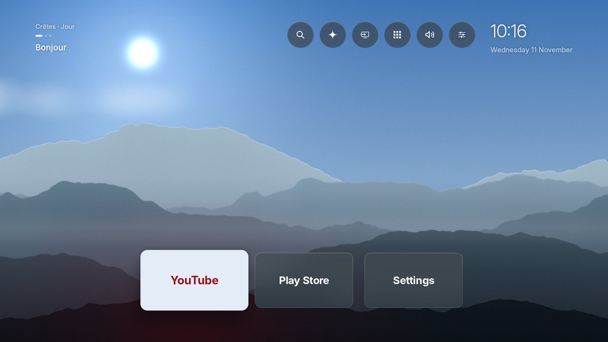

*Captures prises sur un émulateur Android TV (1080p) avec Lumen 4.26.3, refaites automatiquement par la CI (`tools/captures.sh`).*

Lumen remplace l'accueil de la TV : tes applis en vignettes de verre sur un fond vivant (paysages qui suivent le soleil et la météo, photos, vidéos), et autour, tout ce qu'on attend d'un salon tranquille : ambiances avec minuterie de sommeil, mode veille, lumières de la maison, télécommande sur le téléphone, profils et code PIN. Tout se règle à la télécommande, en français ou en anglais.

Installation et utilisation détaillée : [INSTALLATION.md](INSTALLATION.md) · Sécurité et organisation du code : [SECURITE.md](SECURITE.md)

---

## L'accueil

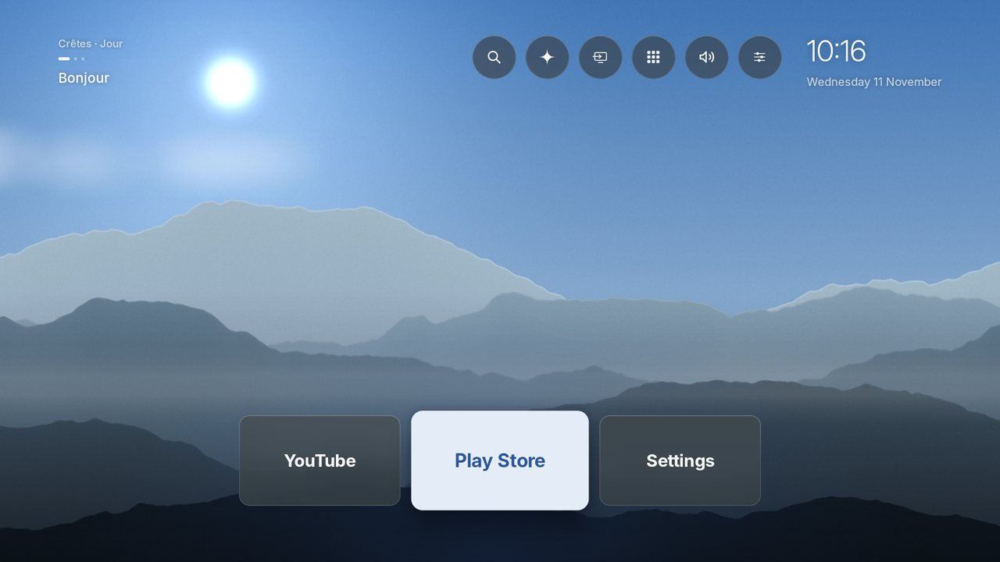

- **Favoris** en vignettes de verre, centrés, de 1 à 3 lignes de 3 à 7 applis. L'appli sélectionnée s'éclaire, une lueur de sa couleur monte en dessous.
- **Boutons ronds** en haut : Rechercher, Ambiances, Entrées (HDMI, chaînes), Maison, Profils, Toutes les applications, Sons (coupés d'un appui), Réglages. À droite, l'horloge et la date.
- **Bandeau d'accueil** sous le nom du fond : salutation selon l'heure, météo de ta ville, dernier épisode en cours.
- **État de la TV** sous l'horloge, seulement quand il y a quelque chose à dire : pas de réseau, pile de la télécommande faible, mise à jour prête.
- **Applis selon l'heure** : l'appli que tu ouvres d'habitude à ce moment est déjà sélectionnée (calcul fait sur la TV, rien n'est envoyé).
- **Reprendre** : sur une appli (Netflix, Prime Video, Plex…), ses épisodes en cours apparaissent juste au-dessus, avec l'affiche et la progression. ◀ depuis la première vignette : les dernières applis utilisées.
- **À l'affiche** (▶ depuis la dernière vignette, clé TMDB facultative) : films et séries du moment, filtrés sur tes applis, avec « Regarder sur… », bande-annonce et titres similaires.
- **Appui long sur OK** : déplacer, ajouter ou retirer des favoris, masquer, verrouiller par code, fermer, infos, désinstaller.
- Au bout de 45 s sans toucher la télécommande, l'interface s'efface pour laisser le fond.

## Toutes les applications et la recherche

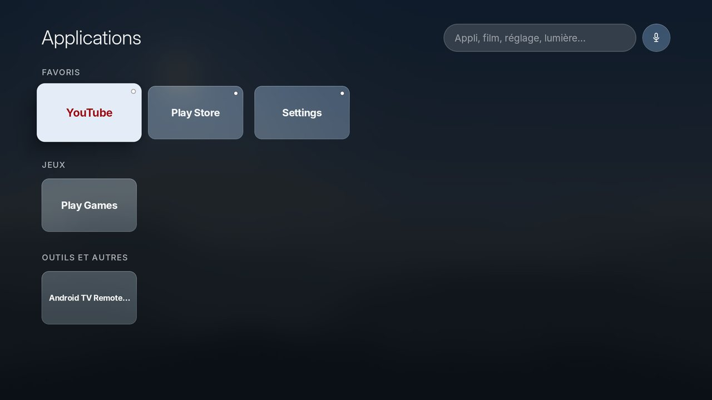

- ▼ depuis l'accueil : une recherche en haut, puis des rangées rangées toutes seules — Favoris, « Ce soir » (les habitudes), Vidéo et TV, Musique et radio, Jeux, Outils et autres, Sources HDMI.
- La **recherche** (loupe, touche Recherche ou micro de la télécommande) trouve les applis, les épisodes en cours, les réglages, les ambiances et les appareils de la maison. Elle tolère les fautes et les initiales (« netflx », « ytm »), et propose « Chercher « … » dans » Google TV ou directement dans Netflix, Plex, YouTube…
- « plex Dune » ou « netflix stranger things » cherche le titre directement dans l'appli.

## Fonds d'écran

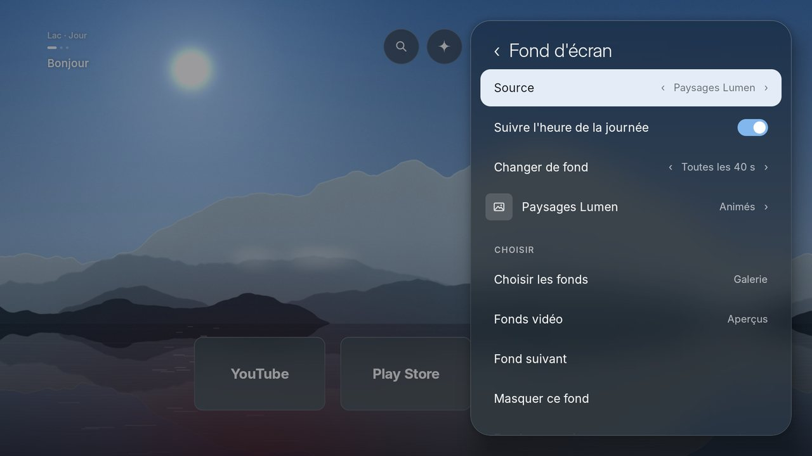 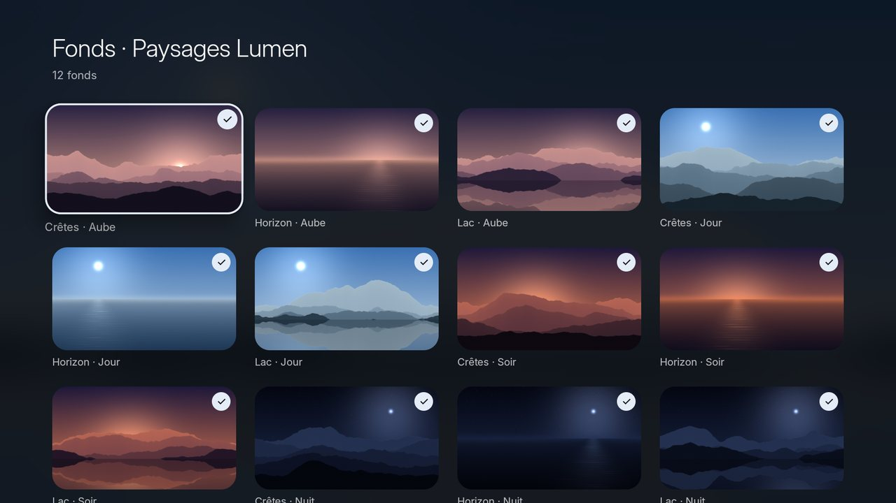

Réglages › Fond d'écran, au choix :

| Source | Ce que c'est |
|---|---|
| **Paysages Lumen** | Crêtes, horizon, lac, générés par Lumen. Aube, jour, soir, nuit suivent le vrai lever et coucher du soleil de ta ville ; nuages, brume, reflets, étoiles filantes ; pluie, neige, orage selon la météo réelle ; neige légère pour les fêtes. |
| **Paysages animés** | Les mêmes en calques qui défilent lentement. |
| **Espace, Nature, Animaux** | Photos primées de Wikimedia Commons et de la NASA, jusqu'en 4K, avec auteur et licence. |
| **Vidéos 4K** | Vraies prises de vue (villes en drone, paysages, la Terre vue de l'ISS), à choisir sur aperçus : rien n'est téléchargé sans être coché. |
| **Mélange de photos**, **Photo du jour** | Les photos mélangées, ou la photo du jour de Wikimedia Commons avec sa légende. |
| **Mes photos et vidéos** | Celles envoyées depuis le téléphone. |

Changement de fond toutes les 15 s à 5 min ou jamais, galerie pour cocher chaque image, « Masquer ce fond », qualité HD ou 4K et place réservée aux vidéos (3 à 20 Go). Lumen garde toujours de la place libre sur la TV.

Les paysages Lumen sont générés par `tools/scenes.py` :

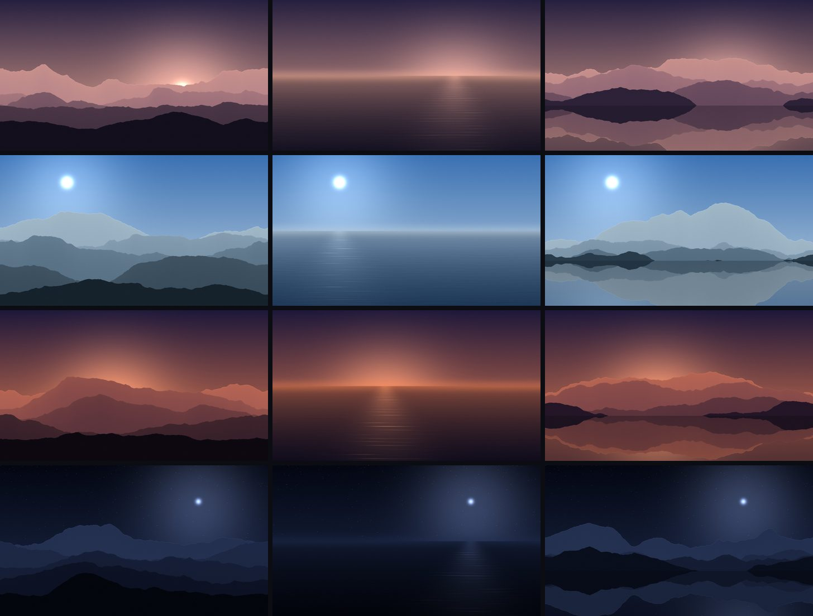

## Ambiances et minuterie de sommeil

Bouton ✦ de l'accueil : de vraies vidéos en plein écran avec leur son — **Cheminée, Pluie, Aquarium, Nuit étoilée, Vagues, Neige**. ◀ ▶ changent d'ambiance, OK ouvre le menu : choisir les vidéos (sur aperçus), couper le son, **minuterie** de 15, 30, 60 ou 90 min (le son baisse, l'écran passe au noir, la TV se met en veille). Tes propres vidéos, envoyées depuis le téléphone, passent en premier.

## Mode veille

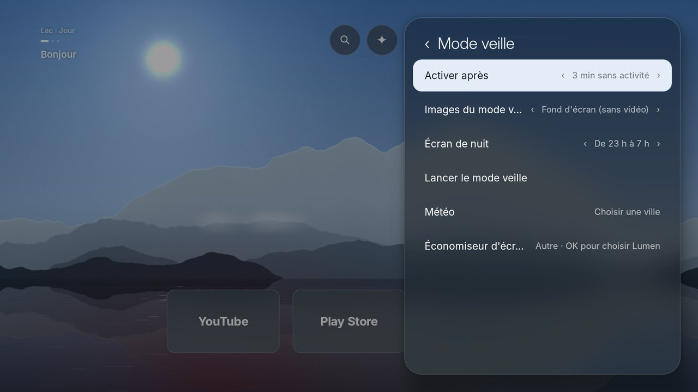 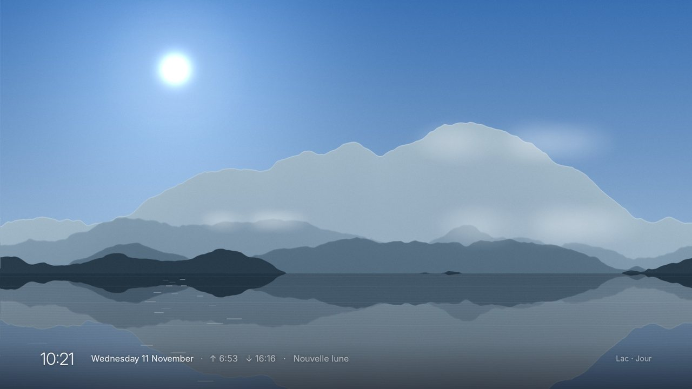

- Après 1 à 10 minutes sans activité (ou jamais) : le fond en plein écran et **une seule ligne** discrète — heure, date, météo, lever et coucher du soleil, phase de la Lune, légende de l'image. Elle bouge de quelques pixels chaque minute pour protéger l'écran.
- **Écran de nuit** (de 22 h, 23 h ou minuit jusqu'à 7 h) : presque noir, une grande horloge très douce.
- Images au choix (comme l'accueil, paysages, espace, nature, photos…), et Lumen peut devenir l'**économiseur d'écran officiel** de la TV, par-dessus n'importe quelle appli.

## Le téléphone comme télécommande

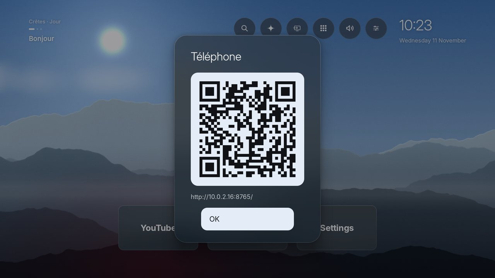 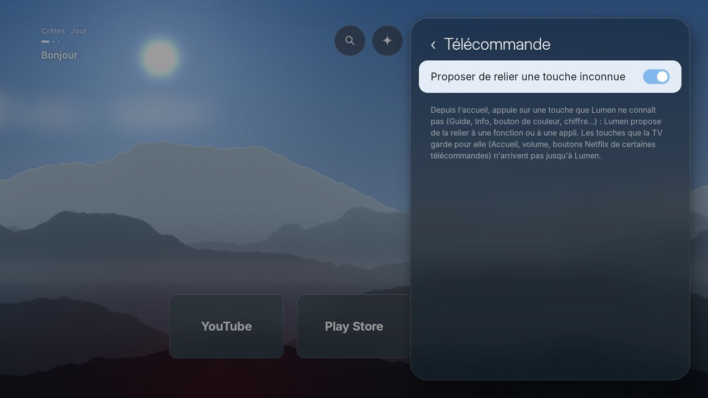

Réglages › Réglages depuis le téléphone affiche un **QR code** : scanné sur le même Wi-Fi, il ouvre une page avec cinq onglets — **TV** (pavé tactile, volume, lecture, écrire ou dicter dans la recherche, ouvrir une appli, une source HDMI, une ambiance), **Accueil** (ranger les favoris, verrouiller une appli), **Vidéos** (cocher les vidéos sur aperçus), **Envois** (tes photos et vidéos), **Plus** (tous les réglages, Home Assistant, stockage, sauvegarde, code PIN). Chaque nouveau téléphone doit être accepté sur la TV ; tout reste sur le réseau local, un seul téléphone à la fois.

## Maison (Home Assistant)

Bouton Maison de l'accueil, une fois Home Assistant relié depuis le téléphone : lumières, prises, scènes, volets et lecteurs en tuiles de verre. Une lumière allumée éclaire sa tuile dans sa vraie couleur ; OK maintenu puis ◀ ▶ règle l'intensité ou la position ; un onglet par pièce. Les scènes favorites se lancent depuis l'accueil, et le mode **Cinéma** tamise les lumières quand un film démarre. Serrures et alarmes ne sont jamais pilotables depuis la TV.

## Profils, enfants et code PIN

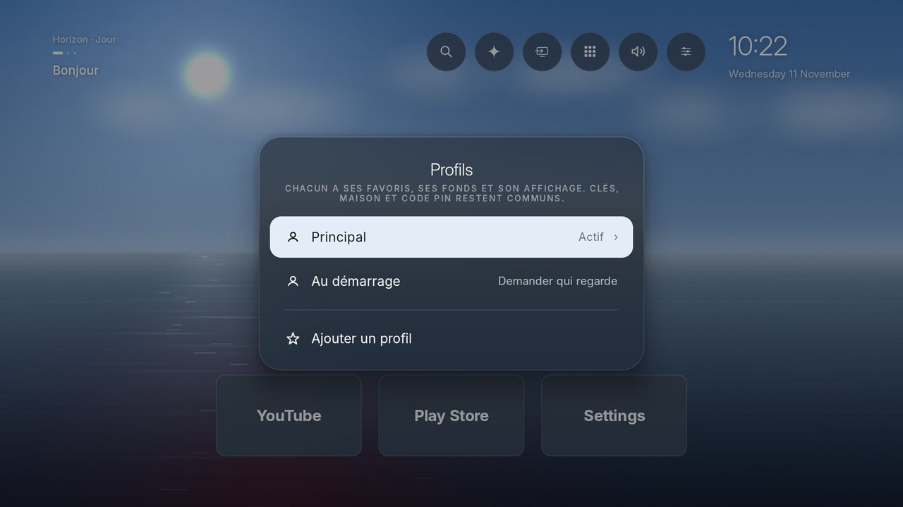

- Un **profil** par personne : favoris, fond, affichage, mode veille, sons, recherches et habitudes. Dès deux profils, « Qui regarde ? » s'affiche au démarrage.
- **Profil enfant** : seulement ses applis favorites ; tout le reste (réglages, autres applis, sortir du profil) demande le code.
- **Code PIN** facultatif pour les réglages, la désinstallation et les applis verrouillées.

## Tous les réglages

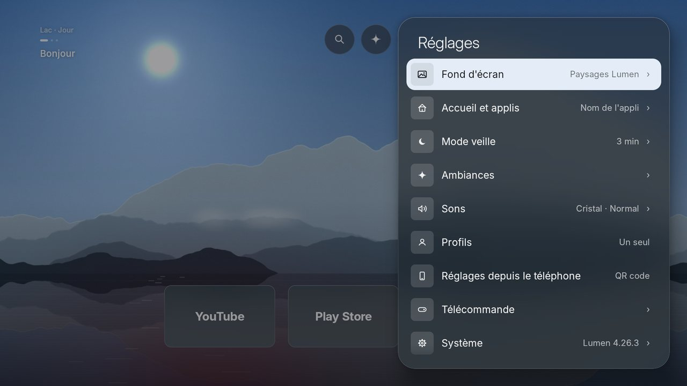 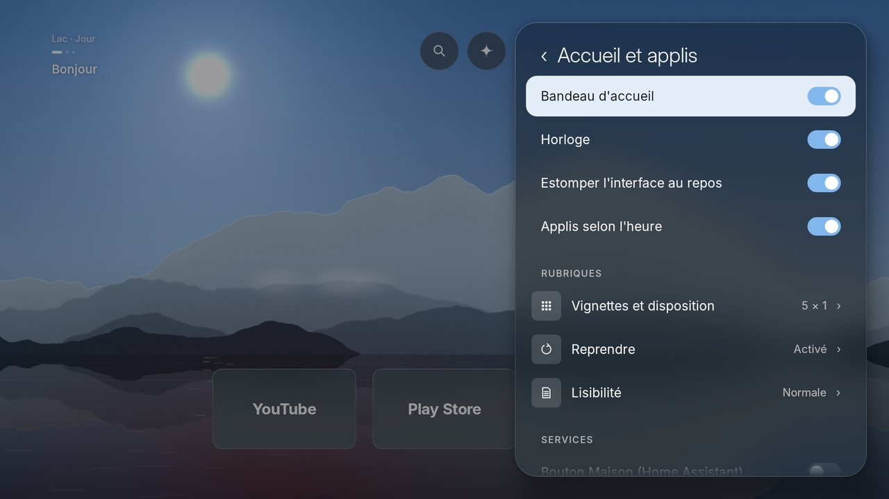
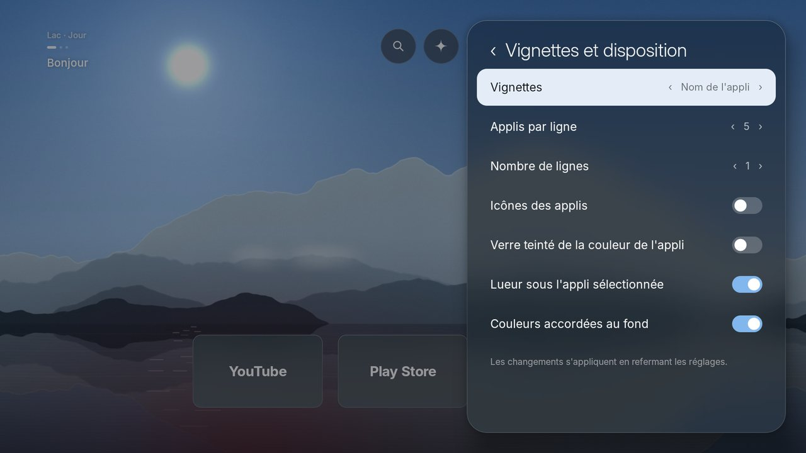 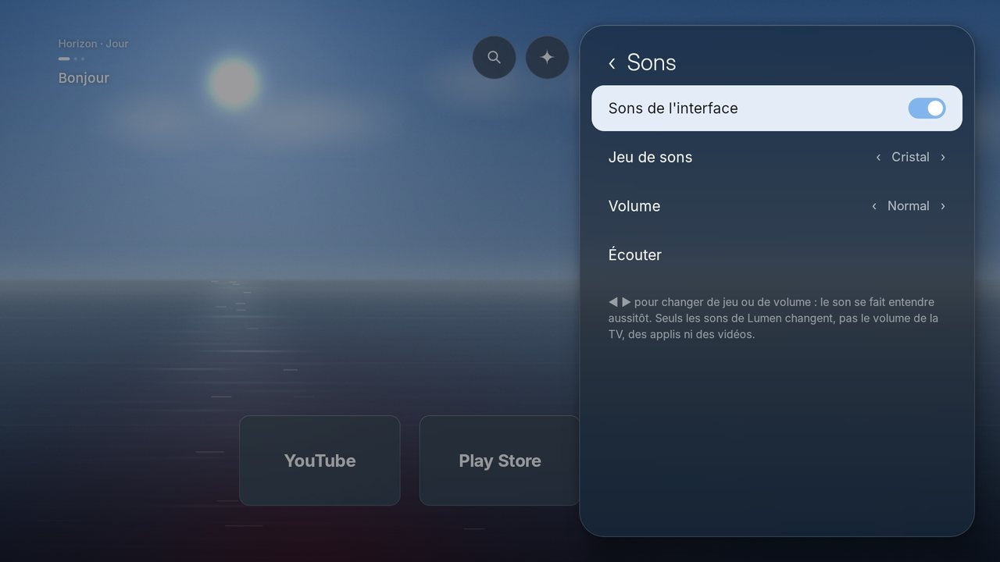
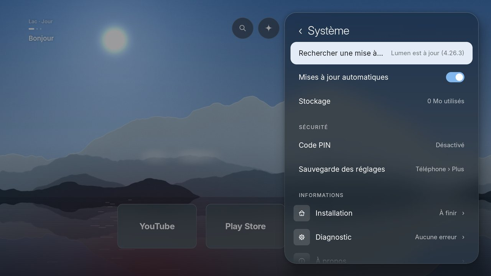

Bouton Réglages ou touche Menu. Les réglages à deux états ont un interrupteur ; ceux à plusieurs valeurs se changent avec ◀ ▶ sans quitter la ligne.

| Rubrique | Ce qu'on y règle |
|---|---|
| **Fond d'écran** | Source, suivre l'heure de la journée, rythme de changement, Paysages Lumen (animés, météo, décors de saison), galerie, fonds vidéo, fond suivant, masquer un fond ; Avancé : 4K/HD, place pour les vidéos, thème et villes des vidéos, clé Pexels |
| **Accueil et applis** | Bandeau d'accueil, horloge, estomper l'interface au repos, applis selon l'heure ; Vignettes et disposition (nom, icône et nom, bannières officielles ; applis par ligne, nombre de lignes ; verre teinté, lueur, couleurs accordées au fond) ; Reprendre (affiches, fond de l'épisode en cours) ; Lisibilité (langue, taille du texte, contraste renforcé) ; bouton Maison ; À l'affiche (clé TMDB, plateformes, tri, historique) ; applis masquées |
| **Mode veille** | Délai, images, écran de nuit, lancer le mode veille, ville pour la météo, économiseur d'écran de la TV |
| **Ambiances** | Ouvrir, choisir les vidéos, son de la vidéo |
| **Sons** | Sons de l'interface, jeu de sons (Cristal, Bois, Gouttes, Ouate), volume propre à Lumen, écouter |
| **Profils** | Ajouter, renommer, supprimer, profil enfant, profil au démarrage |
| **Réglages depuis le téléphone** | QR code, accès du téléphone (complet ou télécommande seulement), télécommande dans les autres applis |
| **Télécommande** | Relier les touches sans rôle (Guide, Info, couleurs, chiffres…) à une fonction ou à une appli |
| **Système** | Mises à jour (automatiques, nouveautés), stockage, code PIN, sauvegarde des réglages, assistant d'installation, diagnostic (mesures à l'écran, journal d'erreurs, redémarrer Lumen), à propos, licences |

## Accessibilité

Français ou anglais (réglage par profil), trois tailles de texte, contraste renforcé, lecteur d'écran TalkBack pris en charge, recherche vocale par le micro de la télécommande.

## Vie privée

Aucune publicité, aucun compte, aucune télémétrie. Internet sert seulement à télécharger, en HTTPS et depuis une liste fermée de serveurs (Wikimedia Commons, NASA, Open-Meteo ; TMDB et Pexels seulement avec ta clé), des contenus sous licence libre, vérifiés avant affichage. Les habitudes et l'historique restent sur la TV. Détails dans [SECURITE.md](SECURITE.md).

## Installer

En bref (détails et commandes exactes dans [INSTALLATION.md](INSTALLATION.md)) : activer le débogage USB sur la TV, `adb install Lumen.apk`, puis désactiver l'accueil Google (réversible). Au premier lancement, Lumen affiche lui-même un **assistant d'installation** avec l'état de la TV, les commandes à copier (adresse IP déjà remplie) et un QR code vers le guide. Ensuite, Lumen se met à jour tout seul depuis les Releases GitHub, après vérification de la signature.

---

## Compiler

Sous Ubuntu/Debian :

    sudo apt install aapt apksigner zipalign dalvik-exchange android-sdk-platform-23 openjdk-17-jdk
    ./build.sh        # produit build/Lumen.apk
    tests/run.sh      # tests

`build.sh` crée une clé de signature locale (`lumen.keystore`) si elle n'existe pas. Garde la même clé pour pouvoir installer les mises à jour par-dessus l'appli existante.

`dist/services.json` : clé TMDB partagée du projet (facultative), proposée aux TV qui n'ont pas de clé personnelle pour « À l'affiche ». Pour la fournir, crée une clé gratuite sur themoviedb.org, mets-la dans le champ `tmdb` et pousse sur `main`.

`tools/i18n_check.py` vérifie que chaque texte de l'interface a sa traduction (`assets/lang/en.tsv`).

`tools/scenes.py` régénère les paysages de `assets/scenes` et `assets/anim` (Python, numpy, Pillow).

Police : Inter (licence OFL, `assets/fonts/LICENCE-Inter.txt`).

## Vérification continue

À chaque envoi, GitHub Actions compile Lumen, lance les tests, contrôle la cohérence de `dist/latest.json` et du `CHANGELOG.md`, puis installe l'APK sur un émulateur Android TV :

- `tools/smoke.sh` parcourt l'accueil, la page Applications et les réglages, et vérifie qu'il n'y a ni plantage ni blocage ;
- `tools/captures.sh` fait ensuite la visite guidée de l'interface en français, écran par écran.

Les captures sont dans l'artefact « captures » de chaque exécution (onglet Actions) ; la CI se relance à la main sur une branche (« Run workflow »). Les deux scripts marchent aussi sur une TV branchée en adb : `tools/smoke.sh build/Lumen.apk captures`, puis `tools/captures.sh captures/visite`. Les captures du README sont celles de `docs/captures/`, réduites à 1280 pixels de large.

## Publier une mise à jour

Les TV équipées de Lumen lisent toutes les 6 heures (ou à l'ouverture de Réglages › Système) `dist/latest.json` sur la branche `main`, puis téléchargent l'APK de la [GitHub Release](https://github.com/jemguib-spec/lumen/releases) correspondante si la version est plus récente. Les nouveautés de la version s'affichent sur la TV (Réglages › Système › Nouveautés).

1. Augmenter `versionCode` et `versionName` dans `AndroidManifest.xml`.
2. Décrire la version dans `CHANGELOG.md` (section `## <version>`) : c'est le texte de la Release et des nouveautés sur la TV.
3. `tools/publish.sh` (compile, lance les tests, crée la Release `v<version>` avec l'APK, met à jour `dist/latest.json`). Nécessite `gh` connecté.
4. Pousser sur `main`.

L'APK doit être signé avec la même clé (`lumen.keystore`, jamais publiée) que la version installée : sinon Lumen le refuse, et Android aussi.

`dist/Lumen.apk` n'est plus qu'un pont pour les TV encore en 4.19 ou avant, qui ne connaissent pas les Releases ; `tools/publish.sh --sans-pont` cesse de le publier quand toutes les TV sont passées.

## Contribuer

Voir [CONTRIBUTING.md](CONTRIBUTING.md) : compiler, tester, proposer une idée ou signaler un problème.

## Licence
Copyright (C) 2026 jemguib-spec. Lumen est un logiciel libre : vous pouvez le redistribuer et le modifier selon les termes de la GNU General Public License, version 3 ou (à votre choix) toute version ultérieure. Il est distribué sans aucune garantie. Voir [LICENSE](LICENSE).
